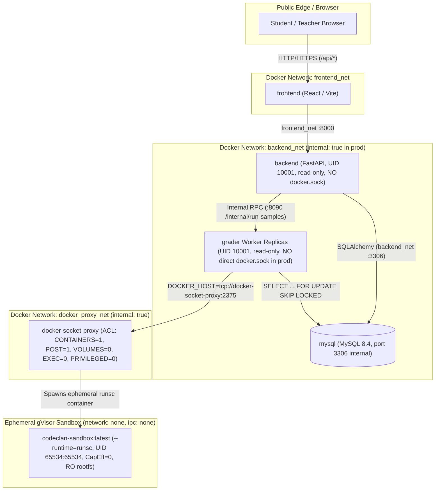

# Code Execution & Automated Grading — Architecture & Production Security Design

Status: **Implemented & Verified (Phase 3 — Production gVisor `runsc` + Hardened Sandbox & Deployment Architecture)**

## 1. Overview

Code Clan evaluates student programs using a dedicated, isolated **`grader`** worker service and ephemeral **`codeclan-sandbox:latest`** containers.

Core invariants:

1. **Zero paid APIs:** All compilation and execution runs locally inside self-hosted containers (no Judge0 Cloud, RapidAPI, or third-party paid services).
2. **Never execute student code inside FastAPI:** `backend` (`FastAPI`) only validates requests, persists `Submission` rows (`status="Pending"`), and proxies sample-run RPC requests to `grader` over the internal `backend_net` network. `backend` does **not** mount `/var/run/docker.sock` and cannot talk to the Docker daemon.
3. **gVisor (`runsc`) User-Space Kernel Isolation + Fail-Closed Production Mode:**
   - On supported Linux servers, every student compilation and testcase container runs with `--runtime runsc` (**gVisor**), intercepting guest system calls inside gVisor's user-space **Sentry** kernel rather than exposing the host Linux kernel directly.
   - At startup, `SandboxExecutor` (`backend/app/grading/sandbox.py`) inspects `docker info` runtimes and executes a live verification probe (`docker run --rm --runtime=runsc ... /bin/cat /proc/version`) to confirm the gVisor Sentry kernel is active.
   - **Fail-Closed Production Enforcement:** When `EXECUTION_ENV=production` or `SANDBOX_REQUIRE_GVISOR=true` (or `SANDBOX_ALLOW_DEV_FALLBACK=false`), if `runsc` is missing or fails verification, `SandboxExecutor` **fails closed** (`blocked=True`, `/health` returns `503`, and no student code is executed).
   - **Honest Local Development Fallback (Windows 11 / Docker Desktop / WSL2):** When `EXECUTION_ENV=development` and `SANDBOX_ALLOW_DEV_FALLBACK=true` on Windows Docker Desktop (where `runsc` is not installed in the managed utility VM), `SandboxExecutor` falls back to hardened `runc` and explicitly reports `gvisor_verified=false`, `production_secure=false`, `fallback_active=true`, and `security_mode="DEVELOPMENT_FALLBACK_DOCKER_RUNC (NOT_PRODUCTION_SECURE)"` on `GET /execution/security-status` and in the UI badge.
4. **Hidden test cases stay server-side:** Public endpoints (`GET /problems`, `GET /problems/{id}`, `POST /submissions/run-samples`, and student calls to `GET /submissions/{id}`) never expose hidden testcase inputs, expected outputs, or actual outputs. Students receive only aggregate hidden testcase counts (`passed / total / failed`).
5. **Cross-student isolation:** Students cannot read or filter another student's submissions (`HTTP 403 Forbidden`).

---

## 2. Production Deployment Architecture



---

## 3. Ephemeral Sandbox Security Controls

Each compilation step and each testcase execution runs inside a brand-new, disposable container created from `codeclan-sandbox:latest` (`backend/sandbox/Dockerfile`) with `shell=False`:

| Control | Flag / Mechanism | Purpose |
|---|---|---|
| Kernel syscall isolation | `--runtime runsc` (gVisor) | Intercepts guest syscalls in gVisor's user-space Sentry kernel on Linux production hosts; verified via `/proc/version` probe. |
| Network isolation | `--network none` | No external internet, DNS, loopback to host, or internal Docker network (`mysql`, `backend`, `grader` unreachable). |
| IPC isolation | `--ipc none` | Private/disabled POSIX/SysV shared memory namespace. |
| Read-only rootfs | `--read-only` | Prevents modifying system binaries, libraries, or writing outside `/work` and `/tmp`. |
| Ephemeral workspace | `--tmpfs /work:rw,exec,nosuid,nodev,size=32m,mode=1777` | In-memory workspace wiped when container exits; no host bind mounts (`-v` is never used). |
| Noexec scratch `/tmp` | `--tmpfs /tmp:rw,noexec,nosuid,nodev,size=16m,mode=1777` | Blocks execution of binaries/scripts dropped into `/tmp`. |
| Non-root user | `--user 65534:65534` (`nobody:nogroup`) | Student code runs as an unprivileged UID/GID. |
| Capability drop | `--cap-drop ALL` | Drops all Linux capabilities (`CapEff: 0000000000000000`). |
| No privilege escalation | `--security-opt no-new-privileges` | Sets `NoNewPrivs: 1`; prevents setuid/setgid binaries from escalating privileges. |
| Memory limit | `--memory 256m --memory-swap 256m` | Caps RAM at 256 MB with zero swap; OOM kills (`exit 137` / `MemoryError`) are caught and reported. |
| CPU limit | `--cpus 0.5` | Prevents CPU starvation on the worker host. |
| Process / fork-bomb limit | `--pids-limit 64`, `--ulimit nproc=64:64`, `RLIMIT_NPROC=32` | Stops fork bombs at both the cgroup (`pids.max`) and kernel RLIMIT layers. |
| File descriptor limit | `--ulimit nofile=64:64` & `RLIMIT_NOFILE=64` | Prevents file-descriptor table exhaustion. |
| File size & core dump limit | `--ulimit fsize=16777216:16777216`, `--ulimit core=0:0` | Prevents disk/tmpfs filling and disables core dumps. |
| Environment scrubbing | `os.environ.clear()` in `sandbox_runner.py` | Only `PATH`, `HOME=/work`, `LANG=C.UTF-8`, and `PYTHONUNBUFFERED=1` exist. Database credentials and `SECRET_KEY` are never present. |
| Stdin isolation | `os.memfd_create` (with unlinked `/tmp` fallback) | Payload is read from pipe, written into an anonymous fd, rewound, and bound to `fd 0` before `os.execvpe` — student code never sees the JSON framing or expected output. |
| Output truncation | Bounded stream reader (`MAX_OUTPUT_BYTES = 65536`) | Caps `stdout` and `stderr` at 64 KB each; programs flooding stdout are killed immediately. |
| Guaranteed cleanup | `try ... finally: docker rm -f <container_name>` | Ensures zero lingering `codeclan-sbx-*` containers after normal exit, compilation failure, OOM, output flood, or timeout. |

---

## 4. Installing & Verifying gVisor (`runsc`) on a Linux Production Server

### Step 1: Install and Register `runsc`
On an Ubuntu/Debian x86_64 or arm64 server with Docker installed, run:
```bash
sudo bash scripts/install-gvisor-linux.sh
```

### Step 2: Verify `runsc` is Registered and Active
1. Confirm `runsc` appears in Docker's runtime map:
   ```bash
   docker info --format '{{json .Runtimes}}'
   ```
   Expected output includes `"runsc":{"path":"runsc"}`.
2. Verify the container runs inside gVisor's user-space Sentry kernel (not the host Linux kernel):
   ```bash
   uname -r
   docker run --rm --runtime=runsc codeclan-sandbox:latest /bin/cat /proc/version
   docker run --rm --runtime=runsc alpine dmesg | head -n 5
   ```
   - `cat /proc/version` inside `--runtime=runsc` prints `Linux version 4.4.0 ...` (gVisor's synthesized kernel version) instead of the host's kernel version.
   - `dmesg` inside `--runtime=runsc` begins with `Starting gVisor...`.
3. Verify CodeClan's live runtime endpoint:
   ```bash
   curl -s http://localhost:8000/execution/security-status | python3 -m json.tool
   ```
   Expected fields on a production Linux + gVisor server:
   - `"active_runtime": "runsc"`
   - `"gvisor_verified": true`
   - `"production_secure": true`
   - `"fallback_active": false`
   - `"security_mode": "PRODUCTION_GVISOR_RUNSC_VERIFIED"`

### Step 3: Start the Production Stack
```bash
docker compose -f docker-compose.prod.yml up -d --build
```
*(In `docker-compose.prod.yml`, `EXECUTION_ENV=production`, `SANDBOX_REQUIRE_GVISOR=true`, and `SANDBOX_ALLOW_DEV_FALLBACK=false` are enforced automatically.)*
